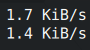
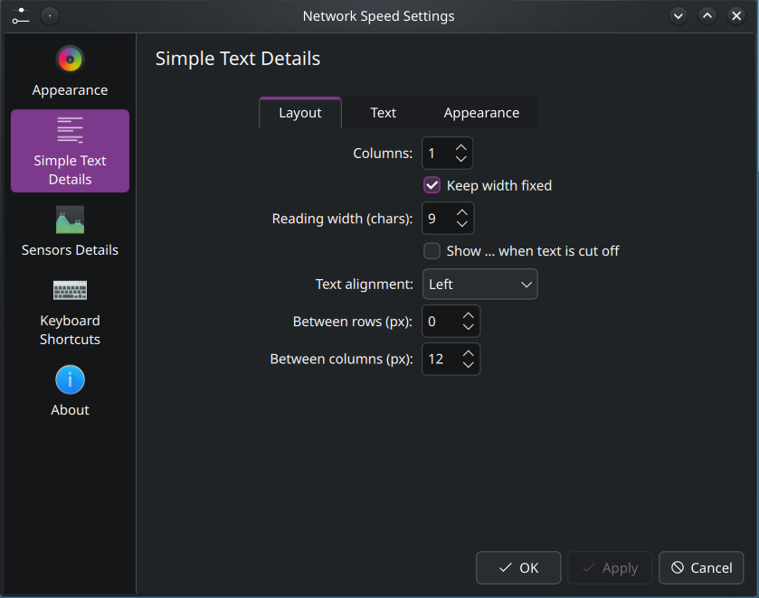

# Simple Text



A customizable text display style for KDE Plasma 6 System Monitor and its desktop and panel widgets. Show network speed, CPU usage, memory, or other sensor readings in rows and columns.

Customize fonts, colors, spacing, and labels. Fixed-width readings keep the widget from resizing as values change, with optional dots (…) for text that does not fit.

## Installation

Requires KDE Plasma 6 and `kpackagetool6`.

1. Download and extract this repository.
2. Open a terminal in the extracted folder and run:

   ```sh
   sh install.sh
   ```

3. Open your System Monitor widget or chart settings, choose **Simple Text** as the display style, and add readings under **Sensors**.

Run the same command to update, then reopen System Monitor or reload the widget.

## Text format

- `{value}` — the reading with its unit, such as `12 KiB/s`.
- `{name}: {value}` — the sensor label followed by its reading.

Use the **Layout**, **Text**, and **Appearance** tabs to customize the display.

## Settings preview


